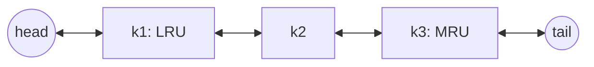

# 146. LRU Cache

[LeetCode](https://leetcode.com/problems/lru-cache/) · **Medium** · Pattern: [Linked List](README.md) · [All patterns](../README.md) · [Home](../../README.md)

> **Key insight:** Hash map for O(1) lookup + doubly linked list for O(1) recency updates; sentinels remove edge cases.

## Approach

1. **Need:** `get` and `put` in O(1), evicting the least recently used key when full.
2. **Brute force:** a list ordered by use; moving a key to the front is O(n).
3. **Optimization:** a hash map `key -> node` finds the node in O(1); a doubly linked list moves or removes it in O(1). Keep the most recent node next to the tail sentinel and evict `head.next`.
4. **Sentinels** (dummy head and tail) mean insert and remove never check for `None`.



| | Complexity |
|---|---|
| Time | `O(1) per get/put` |
| Space | `O(capacity)` |

## Solution

<!-- prep:solutions:start -->
<details>
<summary><b>Python</b> (spoiler) · <code>0146-lru-cache.py</code></summary>

```python
class Node:
    __slots__ = ("key", "val", "prev", "next")

    def __init__(self, key: int = 0, val: int = 0):
        self.key, self.val = key, val
        self.prev = self.next = None


class LRUCache:
    def __init__(self, capacity: int):
        self.cap = capacity
        self.map: dict[int, Node] = {}
        self.head, self.tail = Node(), Node()  # head.next = least recent, tail.prev = most recent
        self.head.next, self.tail.prev = self.tail, self.head

    def _remove(self, node: Node) -> None:
        node.prev.next, node.next.prev = node.next, node.prev

    def _append(self, node: Node) -> None:
        node.prev, node.next = self.tail.prev, self.tail
        self.tail.prev.next = node
        self.tail.prev = node

    def get(self, key: int) -> int:
        node = self.map.get(key)
        if node is None:
            return -1
        self._remove(node)
        self._append(node)
        return node.val

    def put(self, key: int, value: int) -> None:
        if key in self.map:
            self._remove(self.map[key])
        node = Node(key, value)
        self.map[key] = node
        self._append(node)
        if len(self.map) > self.cap:
            lru = self.head.next
            self._remove(lru)
            del self.map[lru.key]
```

</details>

<details>
<summary><b>Java</b> (spoiler) · <code>0146-lru-cache.java</code></summary>

```java
import java.util.*;

class LRUCache {
    private static class Node {
        int key, val;
        Node prev, next;

        Node(int k, int v) {
            key = k;
            val = v;
        }
    }

    private final int cap;
    private final Map<Integer, Node> map = new HashMap<>();
    private final Node head = new Node(0, 0), tail = new Node(0, 0);

    public LRUCache(int capacity) {
        cap = capacity;
        head.next = tail;
        tail.prev = head;
    }

    private void remove(Node n) {
        n.prev.next = n.next;
        n.next.prev = n.prev;
    }

    private void append(Node n) { // most recently used sits right before tail
        n.prev = tail.prev;
        n.next = tail;
        tail.prev.next = n;
        tail.prev = n;
    }

    public int get(int key) {
        Node n = map.get(key);
        if (n == null) return -1;
        remove(n);
        append(n);
        return n.val;
    }

    public void put(int key, int value) {
        Node n = map.get(key);
        if (n != null) {
            n.val = value;
            remove(n);
            append(n);
            return;
        }
        n = new Node(key, value);
        map.put(key, n);
        append(n);
        if (map.size() > cap) {
            Node lru = head.next;
            remove(lru);
            map.remove(lru.key);
        }
    }
}
```

</details>

<details>
<summary><b>C++</b> (spoiler) · <code>0146-lru-cache.cpp</code></summary>

```cpp
#include <list>
#include <unordered_map>
#include <utility>
using namespace std;

class LRUCache {
    int cap;
    list<pair<int, int>> items;  // front = most recently used
    unordered_map<int, list<pair<int, int>>::iterator> pos;

public:
    explicit LRUCache(int capacity) : cap(capacity) {}

    int get(int key) {
        auto it = pos.find(key);
        if (it == pos.end()) return -1;
        items.splice(items.begin(), items, it->second);  // O(1) move to front
        return it->second->second;
    }

    void put(int key, int value) {
        auto it = pos.find(key);
        if (it != pos.end()) {
            it->second->second = value;
            items.splice(items.begin(), items, it->second);
            return;
        }
        items.emplace_front(key, value);
        pos[key] = items.begin();
        if ((int)items.size() > cap) {
            pos.erase(items.back().first);
            items.pop_back();
        }
    }
};
```

</details>
<!-- prep:solutions:end -->

## Mistakes and edge cases

- Attempt 1: evicted the node from the list but **not from the map**, so `get` returned stale values (needed a hint).
- On `put` of an existing key, update the value **and** move it to most-recent.
- C++: `list::splice` moves a node in O(1) without invalidating iterators, so `std::list` + `unordered_map` is the idiomatic version.

## Attempts

<!-- prep:attempts:start -->
| # | Date | Kind | Time | Target | Outcome | Grade | Lang |
|---|---|---|---|---|---|---|---|
| 1 | 2026-11-10 | first | 34m (over) | 25m | needed hints | good | python |
| 2 | 2026-11-11 | review | 23m (in time) | 25m | solved | good | java |

**Status:** reviewing · **Next review:** 2026-11-14 (interval 3d) · **In-target streak:** 1/2
<!-- prep:attempts:end -->
