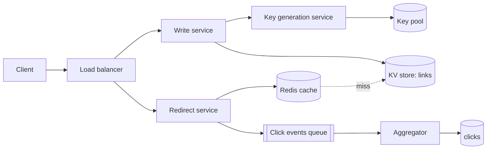

# URL Shortener

[System design](../../README.md) · [All questions](../README.md) · [Concepts](../../concepts/README.md) · [Home](../../../README.md)

> **Key insight:** Reads outnumber writes 100:1, so pre-generated base62 keys + a KV store + a cache in front of redirects handles almost everything.

Timed as a 45-minute mock: `prep start sd url-shortener`, then `prep phase` at the end of each phase.

## 1. Requirements (5 min)

**Functional**

- Shorten a long URL to a 7-character code; optional custom alias and expiry.
- Redirect `GET /{code}` to the long URL.
- Basic click counts per link.

**Non-functional**

- Redirect p99 under 50 ms; 99.99% available for redirects (writes can be slightly less).
- Codes are unguessable enough that links cannot be enumerated.
- Links are durable for years.

**Out of scope:** user accounts and dashboards, spam detection.

## 2. Estimates (5 min)

| Quantity | Estimate |
|---|---|
| New links | 100 M / month → about **40 writes/s** (peak 200) |
| Redirects | 100:1 read ratio → about **4,000 reads/s** (peak 20 k) |
| Storage | 500 bytes/link × 1.2 B links/year → **about 600 GB/year** |
| Key space | base62, 7 chars = 62^7 ≈ **3.5 trillion** codes: enough for centuries |
| Cache | 20% of links get 80% of traffic → about 10 GB of hot links fits in RAM |

## 3. API and data model (10 min)

```http
POST /v1/links        {"url": "...", "alias": "optional", "expires_at": "optional"}  -> 201 {"code": "aZ3kQ9x"}
GET  /{code}          -> 301/302 Location: <long url>
GET  /v1/links/{code}/stats -> {"clicks": 1234}
```

| Table | Key | Fields |
|---|---|---|
| `links` (KV / wide-column) | `code` | `long_url`, `created_at`, `expires_at`, `owner_id` |
| `key_pool` | `code` | pre-generated, unused codes |
| `clicks` (append-only) | `(code, day)` | `count` (aggregated from a stream) |

**301 vs 302:** a 301 is cached by browsers, so there is less load but clicks are lost; a 302 keeps analytics accurate. Choose **302**.

## 4. High-level design (15 min)



- **Write path:** the write service takes a code from the key generation service (it hands out batches of 1,000 to each server, so there are no collisions and no per-request coordination), then stores `code -> url`.
- **Read path:** the redirect service checks Redis first (LRU, TTL), falls back to the KV store and populates the cache.
- **Analytics** are asynchronous: redirects publish click events to a queue and an aggregator writes daily counts, so redirects never wait on analytics.

## 5. Deep dive (10 min)

- **Key generation:** hashing (MD5 of the URL, take 43 bits) needs collision checks and leaks equal URLs. A counter + base62 is predictable. **Pre-generated random keys** handed out in batches are collision-free and unguessable; if a server dies, its unused batch is simply lost (fine at 3.5 T keys).
- **Hot links:** a viral link can mean 50 k req/s on one key. Cache it in Redis plus a small in-process LRU on each redirect server, and serve it from the CDN edge with a short TTL.
- **Sharding:** consistent hashing on `code` across KV nodes; replication factor 3; reads at quorum 1 are fine because links are immutable.
- **Expiry:** lazy (check `expires_at` on read) plus a nightly sweeper; deleted codes are not reused.

## Trade-offs

| Decision | Chosen | Alternative | Why |
|---|---|---|---|
| Code generation | Pre-generated key pool | Hash of the URL / counter | No collisions, unguessable, no hot counter |
| Store | KV / wide-column (DynamoDB, Cassandra) | Postgres | Simple key lookups at scale; no joins needed |
| Redirect | 302 | 301 | Keeps click analytics accurate |
| Analytics | Async queue | Synchronous DB increment | Keeps the redirect path fast |

<details>
<summary><b>Redraw-from-memory checklist</b> (used for reviews)</summary>

- [ ] Requirements and numbers recalled (40 w/s, 4 k r/s, 600 GB/yr, 62^7)
- [ ] API and schema
- [ ] Diagram redrawn without looking
- [ ] Two deep-dive topics explained (key generation, hot keys)

</details>

## Attempts

<!-- prep:attempts:start -->
| # | Date | Kind | Time | Target | Outcome | Grade | Phases (min) |
|---|---|---|---|---|---|---|---|
| 1 | 2026-11-08 | first | 52m (over) | 45m | needed hints | hard | requirements 6, estimates 7, api-data-model 11, high-level-design 18, deep-dive 10 |
| 2 | 2026-11-12 | review | 44m (in time) | 45m | solved | good | requirements 5, estimates 5, api-data-model 9, high-level-design 16, deep-dive 9 |

**Status:** reviewing · **Next review:** 2026-11-15 (interval 3d) · **In-target streak:** 1/2
<!-- prep:attempts:end -->
