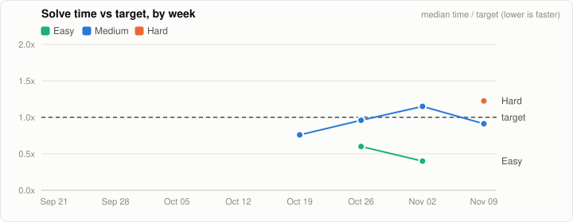
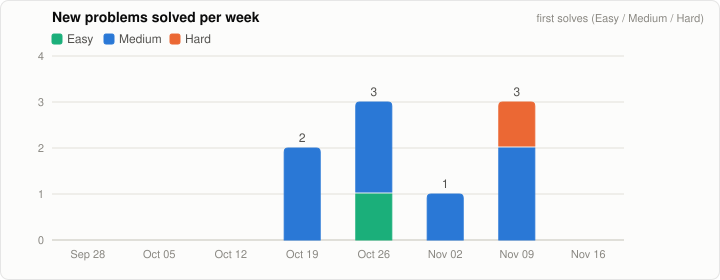
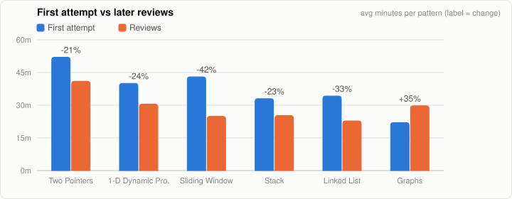

# Interview Prep

My technical interview preparation in one place: LeetCode by pattern, system design, online assessments, behavioral stories, CS fundamentals and mock interviews. Every attempt is **timed** and scheduled for **spaced-repetition review**, and this dashboard is regenerated from the data on every push and once a day.

<!-- prep:dashboard:start -->
    

| Solved | Easy / Med / Hard | NeetCode 150 | Due today | Overdue | Avg time vs target | Next mock | Next interview |
|:---:|:---:|:---:|:---:|:---:|:---:|:---:|:---:|
| **71** | 53 / 17 / 1 | `##........` 25 | **3** | 27 | 0.96x target (29 timed) | 2026-11-21: Pramp coding mock | none yet |

### Focus next

1. **[Graphs](01-dsa-leetcode/11-graphs/README.md)** (score 0.56): median 1.1x target, 100% of reviews regressed
1. **[1-D Dynamic Programming](01-dsa-leetcode/13-1-d-dp/README.md)** (score 0.48): 50% fail/hint rate, median 1.3x target
1. **[Stack](01-dsa-leetcode/04-stack/README.md)** (score 0.34): median 1.2x target

**Slowest patterns (median time / target):** 1-D Dynamic Programming 1.32x · Stack 1.18x · Two Pointers 1.16x

### Due today (3)

| Item | Type | Due | Last result |
|---|---|---|---|
| [450. Delete Node in a BST](01-dsa-leetcode/07-trees/0450-delete-node-in-a-bst.md) | lc | today | solved, - |
| [735. Asteroid Collision](01-dsa-leetcode/04-stack/0735-asteroid-collision.md) | lc | today | solved, - |
| [1456. Maximum Number of Vowels in a Substring of Given Length](01-dsa-leetcode/03-sliding-window/1456-maximum-number-of-vowels-in-a-substring-of-given-length.md) | lc | today | solved, - |

### Overdue (27)

| Item | Type | Due | Last result |
|---|---|---|---|
| [739. Daily Temperatures](01-dsa-leetcode/04-stack/0739-daily-temperatures.md) | lc | 12d late | solved, 21m |
| [704. Binary Search](01-dsa-leetcode/05-binary-search/0704-binary-search.md) | lc | 11d late | solved, 6.0m |
| [322. Coin Change](01-dsa-leetcode/13-1-d-dp/0322-coin-change.md) | lc | 11d late | solved, 28m |
| [42. Trapping Rain Water](01-dsa-leetcode/02-two-pointers/0042-trapping-rain-water.md) | lc | 7d late | solved, 41m |
| [102. Binary Tree Level Order Traversal](01-dsa-leetcode/07-trees/0102-binary-tree-level-order-traversal.md) | lc | 7d late | solved, 13m |
| [200. Number of Islands](01-dsa-leetcode/11-graphs/0200-number-of-islands.md) | lc | 7d late | needed hints, 28m |
| [146. LRU Cache](01-dsa-leetcode/06-linked-list/0146-lru-cache.md) | lc | 6d late | solved, 23m |
| [Caching](02-system-design/concepts/caching.md) | concept | 6d late | solved, 7.0m |
| _+19 more:_ `prep due` | | | |

### Speed

| Difficulty | Target | Attempts | Average | Median | Within target | First try avg | Review avg |
|---|---:|---:|---:|---:|---:|---:|---:|
| Easy | 15m | 2 | 7.5m | 7.5m | 100% | 9.0m | 6.0m |
| Medium | 25m | 23 | 24m | 23m | 57% | 28m | 21m |
| Hard | 40m | 4 | 48m | 49m | 0% | 54m | 44m |

| Last 4 weeks | Oct 26 | Nov 02 | Nov 09 | Nov 16 |
|---|---:|---:|---:|---:|
| New solved | 3 | 1 | 3 | 0 |
| Reviews | 3 | 7 | 5 | 0 |
| Avg time | 22m | 24m | 34m | - |
| Median time / target | 0.92x | 1.12x | 1.12x | - |
| Within target | 67% | 44% | 33% | - |

<p> </p>
<p></p>

<details>
<summary><b>Breakdown by pattern</b></summary>

| Pattern | Solved | NeetCode 150 | Avg | Median | Within target | First / review | Weakness |
|---|---:|---|---:|---:|---:|---|---:|
| [Arrays & Hashing](01-dsa-leetcode/01-arrays-hashing/README.md) | 8 | `###.......` 3/9 | 18m | 18m | 83% | 24m / 15m | 0.13 |
| [Two Pointers](01-dsa-leetcode/02-two-pointers/README.md) | 13 | `########..` 4/5 | 46m | 46m | 0% | 52m / 41m | 0.28 |
| [Sliding Window](01-dsa-leetcode/03-sliding-window/README.md) | 4 | `###.......` 2/6 | 31m | 28m | 50% | 43m / 25m | 0.31 |
| [Stack](01-dsa-leetcode/04-stack/README.md) | 4 | `###.......` 2/7 | 28m | 30m | 33% | 33m / 25m | 0.34 |
| [Binary Search](01-dsa-leetcode/05-binary-search/README.md) | 4 | `#.........` 1/7 | 7.5m | 7.5m | 100% | 9.0m / 6.0m | 0.17 |
| [Linked List](01-dsa-leetcode/06-linked-list/README.md) | 7 | `####......` 4/11 | 28m | 28m | 50% | 34m / 23m | 0.32 |
| [Trees](01-dsa-leetcode/07-trees/README.md) | 14 | `###.......` 4/15 | 16m | 16m | 100% | 18m / 13m | 0.12 |
| [Tries](01-dsa-leetcode/08-tries/README.md) | 1 | `..........` 0/3 | - | - | - | - | 0.20 |
| [Heap / Priority Queue](01-dsa-leetcode/09-heap-priority-queue/README.md) | 0 | `..........` 0/7 | - | - | - | - | 0.20 |
| [Backtracking](01-dsa-leetcode/10-backtracking/README.md) | 0 | `..........` 0/9 | - | - | - | - | 0.20 |
| [Graphs](01-dsa-leetcode/11-graphs/README.md) | 1 | `#.........` 1/13 | 27m | 28m | 33% | 22m / 30m | 0.56 |
| [Advanced Graphs](01-dsa-leetcode/12-advanced-graphs/README.md) | 0 | `..........` 0/6 | - | - | - | - | 0.20 |
| [1-D Dynamic Programming](01-dsa-leetcode/13-1-d-dp/README.md) | 5 | `##........` 2/12 | 34m | 33m | 0% | 40m / 30m | 0.48 |
| [2-D Dynamic Programming](01-dsa-leetcode/14-2-d-dp/README.md) | 0 | `..........` 0/11 | - | - | - | - | 0.20 |
| [Greedy](01-dsa-leetcode/15-greedy/README.md) | 1 | `..........` 0/8 | - | - | - | - | 0.20 |
| [Intervals](01-dsa-leetcode/16-intervals/README.md) | 0 | `..........` 0/6 | - | - | - | - | 0.20 |
| [Math & Geometry](01-dsa-leetcode/17-math-geometry/README.md) | 5 | `#.........` 1/8 | - | - | - | - | 0.19 |
| [Bit Manipulation](01-dsa-leetcode/18-bit-manipulation/README.md) | 4 | `#.........` 1/7 | - | - | - | - | 0.19 |

</details>

<details>
<summary><b>System design, OA, behavioral, mocks</b></summary>

Design questions: **1** · Concept notes: **2** · OA attempts: **1** · STAR stories: **1** · Mocks logged: **1** · Mastered items: **3**

**Phase timing** (avg of 2 timed designs)

| Phase | Target | Avg | Delta |
|---|---:|---:|---:|
| requirements | 5m | 5.5m | +0.5m |
| estimates | 5m | 6.0m | +1.0m |
| api-data-model | 10m | 10m | +0.0m |
| high-level-design | 15m | 17m | +2.0m |
| deep-dive | 10m | 9.5m | -0.5m |

</details>

<sub>Includes entries tagged <code>sample</code> that show the format. Remove them with <code>prep samples remove</code>.</sub>
<!-- prep:dashboard:end -->

## Repo map

<!-- prep:map:start -->
```text
interview-prep/
├── 01-dsa-leetcode/         LeetCode by pattern (72 problems)
├── 02-system-design/        concepts/, questions/, ood/ (2 entries)
├── 03-online-assessments/   timed OAs by platform (1)
├── 04-behavioral/           STAR stories by theme (1)
├── 05-cs-fundamentals/      OS, networking, databases, concurrency, web, languages
├── 06-mock-interviews/      mock log + action items (1)
├── 07-study-plan/           roadmap, spaced repetition, weekly plan
├── templates/               one template per entry type
├── scripts/                 the `prep` CLI
└── data/                    attempts.csv, config, problem lists, items.json
```

| Section | Jump to |
|---|---|
| [01 · DSA / LeetCode](01-dsa-leetcode/README.md) | [Arrays & Hashing](01-dsa-leetcode/01-arrays-hashing/README.md) · [Two Pointers](01-dsa-leetcode/02-two-pointers/README.md) · [Sliding Window](01-dsa-leetcode/03-sliding-window/README.md) · [Stack](01-dsa-leetcode/04-stack/README.md) · [Binary Search](01-dsa-leetcode/05-binary-search/README.md) · [Linked List](01-dsa-leetcode/06-linked-list/README.md) · [Trees](01-dsa-leetcode/07-trees/README.md) · [Tries](01-dsa-leetcode/08-tries/README.md) · [Heap / Priority Queue](01-dsa-leetcode/09-heap-priority-queue/README.md) · [Backtracking](01-dsa-leetcode/10-backtracking/README.md) · [Graphs](01-dsa-leetcode/11-graphs/README.md) · [Advanced Graphs](01-dsa-leetcode/12-advanced-graphs/README.md) · [1-D Dynamic Programming](01-dsa-leetcode/13-1-d-dp/README.md) · [2-D Dynamic Programming](01-dsa-leetcode/14-2-d-dp/README.md) · [Greedy](01-dsa-leetcode/15-greedy/README.md) · [Intervals](01-dsa-leetcode/16-intervals/README.md) · [Math & Geometry](01-dsa-leetcode/17-math-geometry/README.md) · [Bit Manipulation](01-dsa-leetcode/18-bit-manipulation/README.md) |
| [02 · System design](02-system-design/README.md) | [Concepts](02-system-design/concepts/README.md) · [Questions](02-system-design/questions/README.md) · [OO design](02-system-design/ood/README.md) |
| [03 · Online assessments](03-online-assessments/README.md) | [HackerRank](03-online-assessments/hackerrank/README.md) · [CodeSignal](03-online-assessments/codesignal/README.md) · [Codility](03-online-assessments/codility/README.md) · [LeetCode (company OAs / contests)](03-online-assessments/leetcode/README.md) · [Other platforms](03-online-assessments/other/README.md) |
| [04 · Behavioral](04-behavioral/README.md) | [Stories](04-behavioral/README.md#stories) · [Theme coverage](04-behavioral/README.md#theme-coverage) |
| [05 · CS fundamentals](05-cs-fundamentals/README.md) | [Operating Systems](05-cs-fundamentals/os/README.md) · [Networking](05-cs-fundamentals/networking/README.md) · [Databases](05-cs-fundamentals/databases/README.md) · [Concurrency](05-cs-fundamentals/concurrency/README.md) · [Web & Frontend](05-cs-fundamentals/web/README.md) · [Language Notes](05-cs-fundamentals/languages/README.md) |
| [06 · Mock interviews](06-mock-interviews/README.md) | [Upcoming](06-mock-interviews/README.md#upcoming) · [Action items](06-mock-interviews/README.md#open-action-items) |
| [07 · Study plan](07-study-plan/README.md) | [Roadmap](07-study-plan/roadmap.md) · [Spaced repetition](07-study-plan/spaced-repetition.md) · [This week](07-study-plan/weekly-plan.md) |
| Tooling | [Templates](templates/README.md) · [CLI](scripts/README.md) · [Data](data/README.md) |
<!-- prep:map:end -->

## How it works

```powershell
prep new lc 146            # note + solution file, filed under 06-linked-list with tags
prep start lc 146          # timer starts (pause / resume / status)
prep stop                  # outcome + grade -> data/attempts.csv -> next review date -> dashboard
prep due                   # today's reviews
prep find graphs           # search every section by tag, name or number
```

- **Timing:** targets are Easy 15 · Medium 25 · Hard 40 min; an OA's target is its real limit; system design is a 45-minute mock with five timed phases.
- **Spaced repetition:** reviews come back after 1 → 3 → 7 → 14 → 30 → 60 days. *Again* resets the interval, *Hard* repeats it, *Good* or *Easy* moves forward. An item is mastered after 2 reviews in a row solved within target. [Full method](07-study-plan/spaced-repetition.md).
- **Adaptive plan:** a per-pattern weakness score (failures, slowness, regressions, staleness, coverage) decides where new problems and extra reviews go. [This week's plan](07-study-plan/weekly-plan.md).
- **Sources of truth:** `data/attempts.csv` plus each entry's frontmatter. Everything else is generated. [Data format](data/README.md) · [CLI reference](scripts/README.md).
- **Automation:** a GitHub Action rebuilds this page on push and daily, pulls new solutions from my LeetHub repo, checks every link, and keeps a *Reviews due* issue open while something is due.

<sub>Structure inspired by [tech-interview-handbook](https://github.com/yangshun/tech-interview-handbook) and [system-design-primer](https://github.com/donnemartin/system-design-primer); problem list: [NeetCode 150](https://neetcode.io/practice).</sub>
