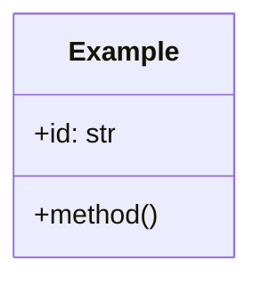

# {{title}} (object-oriented design)

[OO design](../README.md) · [System design](../../README.md) · [Home](../../../README.md)

> **Key insight:** _the abstraction that keeps the design extensible._

## Requirements and use cases

- _..._

## Classes



## Key flows

1. _..._

## Code sketch

<details>
<summary>Code (spoiler)</summary>

```python
class Example:
    pass
```

</details>

## Attempts

<!-- prep:attempts:start -->
<!-- prep:attempts:end -->
