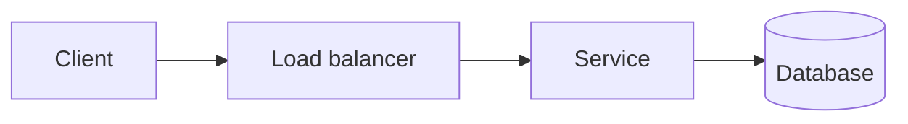

# {{title}}

[System design](../../README.md) · [All questions](../README.md) · [Concepts](../../concepts/README.md) · [Home](../../../README.md)

> **Key insight:** _the one decision that shapes the whole design._

Timed as a 45-minute mock: `prep start sd {{slug}}`, then `prep phase` at the end of each phase.

## 1. Requirements (5 min)

**Functional**

- _..._

**Non-functional**

- _availability / latency / consistency / durability targets_

**Out of scope:** _..._

## 2. Estimates (5 min)

| Quantity | Estimate |
|---|---|
| DAU | |
| Writes / s | |
| Reads / s | |
| Storage / year | |

## 3. API and data model (10 min)

```http
POST /v1/...
GET  /v1/...
```

| Table | Key | Fields |
|---|---|---|
| | | |

## 4. High-level design (15 min)



## 5. Deep dive (10 min)

- _bottleneck 1 and how you remove it_
- _bottleneck 2_

## Trade-offs

| Decision | Chosen | Alternative | Why |
|---|---|---|---|
| | | | |

<details>
<summary><b>Redraw-from-memory checklist</b> (used for reviews)</summary>

- [ ] Requirements and numbers recalled
- [ ] API and schema
- [ ] Diagram redrawn without looking
- [ ] Two deep-dive topics explained

</details>

## Attempts

<!-- prep:attempts:start -->
<!-- prep:attempts:end -->
